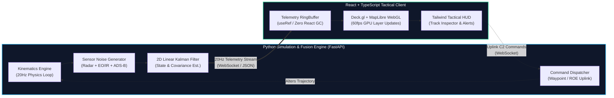

**Kestrel C2** is a browser-based Command and Control (C2) Ground Control Station and synthetic airspace simulation testbed. Named after the kestrel's ability to hover motionless while locking onto high-speed ground targets, the system demonstrates real-time multi-sensor data fusion, kinematic state estimation, and 60fps WebGL geospatial rendering for autonomous UAV swarms.

> **[Live Interactive Demo (Vercel)](#)** *(Link active upon Phase 4 deployment)*  
> **[Technical Deep-Dive & Architecture Walkthrough](#)** *(Substack / LinkedIn companion article)*

---

## 1. Engineering Problem & Motivation

Modern tactical C2 systems face two primary bottlenecks:
1. **Sensor Noise & Asynchrony:** Edge sensors (X-band radar, EO/IR cameras, RF/ADS-B receivers) report target coordinates at irregular intervals with distinct Gaussian noise profiles.
2. **Browser Main-Thread Starvation:** Naively binding high-frequency WebSocket telemetry (`20Hz–60Hz`) across dozens of entities to React component state triggers severe garbage collection pauses and frame drops.

**Kestrel C2** resolves both by decoupling physics and Kalman state estimation in an asynchronous Python engine from a zero-DOM-overhead WebGL rendering pipeline in React and TypeScript.

---

## 2. System Architecture



---

## 3. Core Technical Capabilities

* **Multi-Sensor Data Fusion (Kalman Filtering):** Fuses asynchronous, noisy radar range/bearing observations with high-precision EO/IR detections into a unified state vector $[x, y, v_x, v_y]^T$ with real-time error-covariance visualization.
* **Zero-DOM-Overhead Rendering Pipeline:** High-frequency telemetry packets bypass React's reconciliation cycle via mutable `useRef` track stores and feed directly into GPU-accelerated **Deck.gl** `ScatterplotLayer`, `PathLayer`, and `IconLayer` primitives.
* **Bi-Directional C2 Tasking:** Operators can select friendly autonomous assets on the map and issue live waypoint re-tasking commands over WebSockets, immediately altering simulated flight trajectories.
* **Automated Geofence & Threat Classification:** Evaluates entity kinematics against polygonal Restricted Operating Zones (ROZs), dynamically elevating track states (`FRIENDLY`, `UNKNOWN`, `HOSTILE`) in accordance with tactical symbology conventions.
* **Real-Time Telemetry Diagnostics HUD:** Monitors live WebSocket ingestion rate (`Hz`), serialization-to-paint latency (`ms`), and active track count.

---

## 4. Phased Implementation Roadmap & Progress

### Phase 0: Repository Scaffolding & Architecture Setup
- [x] **0.1** Initialize monorepo structure (`frontend/` + `backend/`) in GitHub Codespaces
- [x] **0.2** Configure React 18, TypeScript strict mode, and Tailwind CSS dark-mode theme
- [ ] **0.3** Add MIT License, `.gitignore`, and GitHub Actions CI workflow

### Phase 1: Python Simulation & Kalman Fusion Engine (`backend/`)
- [ ] **1.1** Define strict Pydantic telemetry & command schemas (`TrackState`, `SensorObservation`, `C2Command`)
- [ ] **1.2** Implement 2D Linear Kalman Filter (`kalman.py`) with NumPy state transition ($F$) and covariance ($P$) matrices
- [ ] **1.3** Build 20Hz multi-entity kinematics simulator with synthetic Radar & EO/IR Gaussian noise injection
- [ ] **1.4** Expose FastAPI bi-directional WebSocket endpoint (`/ws/telemetry`) with automated Pytest verification

### Phase 2: 60fps WebGL Geospatial Client (`frontend/`)
- [ ] **2.1** Build `useTelemetryStream` hook with `useRef` ring-buffer (decoupling WebSocket ingestion from React renders)
- [ ] **2.2** Integrate MapLibre GL dark tactical basemap and Deck.gl rendering layers (`IconLayer`, `PathLayer`, `ScatterplotLayer`)
- [ ] **2.3** Render sensor fusion toggle layers (Raw Radar Blips vs. EO/IR vs. Kalman Fused Track + Covariance Ellipse)

### Phase 3: Bi-Directional C2 Tasking & Tactical HUD
- [ ] **3.1** Build Tailwind Tactical HUD: Track Inspector panel, Entity Roster, and Live Latency/Hz diagnostics bar
- [ ] **3.2** Implement polygonal Restricted Operating Zone (ROZ) geofencing and automated `UNKNOWN` -> `HOSTILE` threat alerts
- [ ] **3.3** Enable interactive map click-to-dispatch UAV waypoint re-tasking over WebSocket uplink

### Phase 4: Production Deployment, Testing & C++20 Extension
- [ ] **4.1** Deploy `frontend/` to Vercel and `backend/` WebSocket engine to Render/Fly.io
- [ ] **4.2** Record 60-second architectural demo walkthrough and publish technical companion article
- [ ] **4.3** *(Stretch)* Port Kalman Filter tracker core to **C++20** via `pybind11` for deterministic sub-millisecond execution

---

## 5. Tech Stack & Architectural Trade-offs

| Layer | Technology | Engineering Rationale |
| :--- | :--- | :--- |
| **UI Framework** | React 18 + TypeScript | Strict static typing for telemetry schemas prevents runtime deserialization failures under high message loads. |
| **Styling** | Tailwind CSS | Enables rapid construction of high-contrast, low-glare dark-mode operator interfaces. |
| **Geospatial Engine** | Deck.gl + MapLibre GL | WebGL2 instanced rendering handles 1,000+ moving entities and history trails at 60fps without vendor lock-in or paid API keys. |
| **Simulation Backend** | Python 3.11 + FastAPI | Asyncio event loop drives deterministic 20Hz physics ticks alongside non-blocking WebSocket broadcasting. |
| **Math / Estimation** | NumPy | Vectorized matrix operations for state transition ($F$), observation ($H$), and covariance ($P$) updates. |

---

## 6. Verification & Testing Strategy

To ensure mathematical accuracy in state estimation and resilience against malformed telemetry packets, Kestrel C2 includes targeted automated tests:

* **Filter Convergence Tests (`backend/tests/test_kalman.py`):** Verifies using `pytest` that the 2D Kalman Filter reduces Root Mean Square Error (RMSE) by `>60%` compared to raw noisy radar measurements across linear and maneuvering target trajectories.
* **Schema & WebSocket Contract Tests (`backend/tests/test_ws.py`):** Validates bidirectional serialization/deserialization of `C2Command` waypoint uplinks and simulated packet drop recovery.
* **Frontend Buffer & Type Safety (`frontend/src/__tests__/`):** Uses `vitest` to verify ring-buffer history capping (preventing memory leaks during multi-hour sessions) and strict TypeScript schema guards.

---

## 7. Quick Start (GitHub Codespaces & Local)

### Prerequisites
* Node.js `>= 18.x`
* Python `>= 3.10`

### 1. Start the Simulation & Fusion Engine
```bash
cd backend
python -m venv .venv && source .venv/bin/activate
pip install -r requirements.txt
uvicorn main:app --host 0.0.0.0 --port 8000 --reload
```

### 2. Start the Tactical C2 Frontend
```bash
cd frontend
npm install
npm run dev
```
*(In GitHub Codespaces, set port `8000` visibility to **Public** under the **Ports** tab so the browser client can establish the WebSocket connection.)*

---

## Author

Engineer: **Murigu Gitonga** — Full-Stack & Simulation Engineer specializing in real-time tactical interfaces, multi-sensor fusion, and cloud-edge systems.  
* **Defence Tech Writing:** [Link to your Substack / Medium / Blog]  
* **LinkedIn:** https://linkedin.com/in/murigugitonga